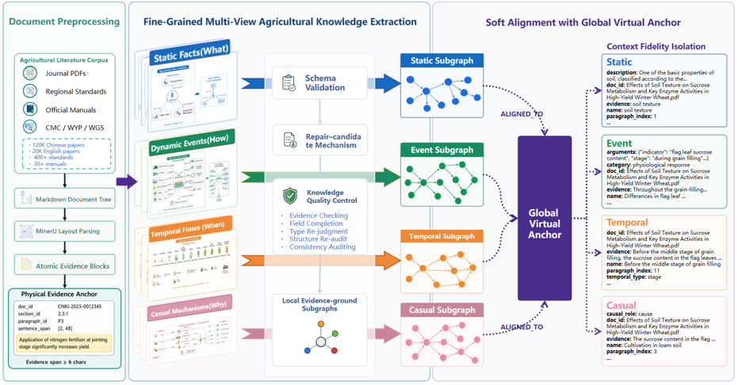

# Four-Stage Scientific Knowledge Extraction

> Prepublication artifact for confidential peer review. This repository contains
> a curated implementation snapshot, not the full development workspace.

本仓库提供面向科研文献的四阶段知识抽取审稿材料，覆盖静态知识、事件知识、
时序关系和因果机制。代码通过 OpenAI-compatible API 调用大语言模型，采用动态
Schema，不进行模型微调。

## Framework Overview



图中展示完整研究框架的总体设计。本审稿快照仅开放其中的四视图知识抽取、
Schema 校验、证据定位和评测相关实现；PDF 预处理、版面解析及完整的下游系统
不在本次仓库范围内。

## 审稿材料范围

仓库包含：

- 四个独立的阶段抽取入口及其必要依赖；
- 论文实验使用的四类中文提示词；
- 脱敏的参考推理配置；
- coarse-grained 与 fine-grained 评测代码；
- 20 条原创合成文本和一组可离线评分的合成 fixture；
- 一组不包含真实论文数据的合成离线评测样例。

仓库不包含：原始 PDF、真实段落、完整金标与银标、真实数据集统计、论文实验
结果、API 凭据、服务端点、完整模型响应、开发日志、论文草稿及未在论文中使用的模块。

## 目录结构

```text
configs/                 模型、推理和评测口径
data/                    原创合成样例
docs/                    数据、配置、评测说明与文档图片
examples/evaluation/     可离线评分的合成 gold/prediction
results/                 本地运行结果目录说明
scripts/extraction/      四个独立阶段入口
scripts/evaluation/      coarse/fine-grained 评分器
src/                     四阶段核心实现与中文 prompts
tests/                   不调用外部 API 的单元测试
```

## 环境

- Python 3.10-3.12
- OpenAI-compatible chat-completions endpoint
- Neo4j 可选；默认不写入数据库

逐步安装：

```bash
python -m venv .venv
source .venv/bin/activate
python -m pip install --upgrade pip
python -m pip install -r requirements.txt
cp .env.example .env
```

Windows PowerShell 使用 `.venv\Scripts\Activate.ps1` 激活环境，并用
`Copy-Item .env.example .env` 创建本地配置。`.env` 已被 Git 忽略，不得提交。

## 分阶段抽取

填写 `.env` 中的 `OPENAI_API_KEY`、`OPENAI_BASE_URL` 和 `OPENAI_MODEL` 后，
分别执行所需阶段。仓库不提供串联全部阶段的一键脚本。

```bash
python scripts/extraction/extract_domain_static.py data/synthetic/demo_document.md
python scripts/extraction/extract_domain_event.py data/synthetic/demo_document.md
python scripts/extraction/extract_domain_temporal.py data/synthetic/demo_document.md
python scripts/extraction/extract_domain_causal.py data/synthetic/demo_document.md
```

各阶段结果写入 `results/extraction/four_stage/knowledge/demo_document/`。在线模型
可能随服务方更新；模型 ID、参考参数和历史记录边界见
[`configs/paper_models.yaml`](configs/paper_models.yaml)。

## 离线评测核验

下面的命令只使用合成 fixture，不访问模型服务：

```bash
python scripts/evaluation/score_gold_predictions.py \
  --gold-dir examples/evaluation/gold \
  --pred-dir examples/evaluation/predictions \
  --static-metric combined \
  --match-mode relaxed_ultra \
  --eval-scope positive_only \
  --output results/smoke/score
```

预期四类 P/R/F1 均为 `1.0`。这里的满分仅用于验证评分器能够正确处理完全
一致的合成 gold/prediction，不代表论文实验结果。评测规则见
[`docs/EVALUATION.md`](docs/EVALUATION.md)。

Fine-grained slot 指标可单独核验：

```bash
python scripts/evaluation/score_gold_finegrained.py \
  --gold-dir examples/evaluation/gold \
  --pred-dir examples/evaluation/predictions \
  --output results/smoke/fine \
  --model synthetic \
  --match-mode relaxed_ultra \
  --eval-scope positive_only
```

## 测试

```bash
python -m unittest discover -s tests -v
```

测试不需要 API Key，覆盖 prompt 合约、Schema 校验、章节来源定位和评分器。

文件完整性可使用以下命令检查：

```bash
sha256sum -c MANIFEST.sha256
```

## 使用限制

本材料仅用于保密同行评审，暂未按开源许可证发布。详见 [`LICENSE`](LICENSE)。
数据可用性与版权边界见 [`docs/DATA_STATEMENT.md`](docs/DATA_STATEMENT.md)。
